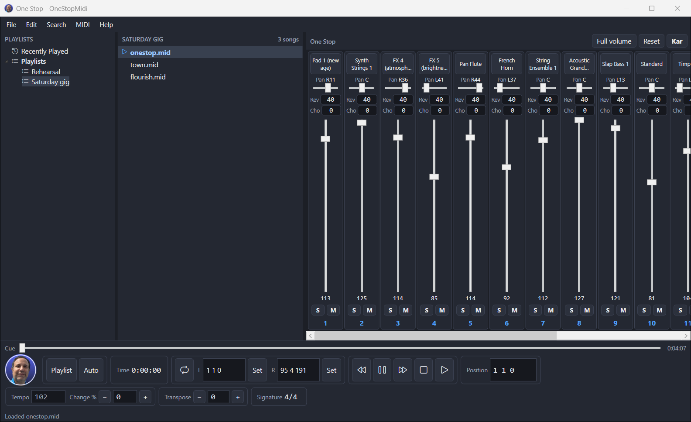

<p align="center">
  
</p>

<h1 align="center">OneStopMidi</h1>

<p align="center">
  A MIDI file player for Windows, built for live use: playlists, a 16-channel mixer, a karaoke and chord view,
  tempo and transpose control, and <b>keyboard shortcuts you can remap completely</b>, so a foot pedal, a presenter
  remote or a numeric keypad can run the show.
</p>

<p align="center">
  <a href="https://github.com/yarink80/OneStopMidi/releases/latest"><b>Download the installer</b></a> ·
  <a href="#features">Features</a> ·
  <a href="#keyboard-shortcuts">Keyboard</a> ·
  <a href="#playlist-on-startup">Startup playlist</a> ·
  <a href="#building-from-source">Build</a>
</p>

<p align="center">
  
</p>

---

## Install

1. Download **`OneStopMidi-Setup.exe`** from the [latest release](https://github.com/yarink80/OneStopMidi/releases/latest).
2. Run it. It installs for your Windows account only (no administrator rights needed) and adds shortcuts on the
   Desktop and in the Start menu.
3. Because the installer is not code-signed yet, Windows SmartScreen may say "Windows protected your PC".
   Click **More info → Run anyway**.

If you'd rather not install anything, download **`OneStopMidi-Portable.zip`**, unzip it anywhere (a USB stick works)
and run `OneStopMidi.exe`. `SHA256SUMS.txt` lists checksums for both downloads.

**Requirements:** Windows 10 or 11, 64-bit. Nothing else: the .NET runtime is included.
Sound comes from the **Microsoft GS Wavetable Synth** that ships with Windows, or from any MIDI output you choose
in Settings: a hardware synth, a USB MIDI interface, or a virtual port.

**Updates:** use **Help → Check for updates…**. The app downloads the newest release from this repository and
restarts into it.

To uninstall, use **Settings → Apps → Installed apps → OneStopMidi → Uninstall**. Your playlists and settings stay in
`%APPDATA%\OneStopMidi`.

---

## Features

### Playback
- Plays Standard MIDI Files: `.mid`, `.midi`, `.kar` (karaoke) and `.smf`, in formats 0, 1 and 2, plus RIFF `.rmi`.
  Damaged or truncated files are read as far as possible.
- Transport: **Play** (from bar 1, or from the left locator when looping), **Stop** (press it again to go back to the
  start), **Pause/Continue**, **rewind / fast-forward by bar**, and a **cue slider** you can drag to any point.
- **Position** shown as bar · beat · tick, plus elapsed time, total length, time signature and current tempo.
- **Tempo change** in percent (−90 % to +200 %). For songs with a single tempo you can also type an exact BPM.
- **Transpose** ±24 semitones. Drum channels are left alone, and notes that are already sounding still stop
  correctly when you change transpose in the middle of a note.
- **Loop** between a left and a right locator. Set them at the current position with one key.
- **Chase events:** when you start, continue or jump, each channel's instrument, bank, volume, pan, reverb and chorus
  are sent first, so a song played from the middle still sounds right.
- **MIDI click** metronome (channel 10, rim shot) on every beat.
- **Full volume** and **Reset devices** (all notes off, sustain off, pitch bend and modulation reset) in the MIDI menu.

### Playlists
- A **playlist tree** (Recently Played + your playlists) next to the **song list**.
- **Playlist mode:** when a song ends, the next one loads by itself. **Auto:** it also starts playing. Both have
  buttons in the control area and keyboard shortcuts.
- Create, rename (F2), delete and reorder playlists; **sort A–Z** or **shuffle** the songs in a list.
- Add songs with **File → Open**, **Add files from folder(s)**, or by **dragging files and folders from Explorer**.
  Drag songs onto a playlist in the tree to copy them there. **Cut / copy / paste** songs between playlists.
- **Search across all playlists** (Ctrl+F): it shows which playlists contain a song.
- **Recently Played** keeps the last 100 songs you loaded.
- Songs that can't be loaded, or whose file is missing, are shown in **red**.
- **Import** `.txt`, `.m3u`, `.m3u8` and older `.jpl` playlists (UTF-8, UTF-16 or ANSI); **export** one playlist or all of them.
- The first time it starts, OneStopMidi offers to import an existing folder of `.txt` playlists if it finds one.
- Playlists are plain text files (one path per line) in `%APPDATA%\OneStopMidi\Playlists`, easy to back up or edit.

### Mixer
- **16 channel strips**, one per MIDI channel: pan, reverb, chorus, volume fader, **Solo**, **Mute** and the instrument.
- The mixer follows the song as it plays and sends your changes to the synth straight away.
- Click the instrument name to choose any of the **128 General MIDI instruments** or a drum kit.
- **Shift+click** puts a control back to its default. **Alt+drag** a fader to move all the faders together.
  **Shift+Solo** adds a channel to the solo group instead of soloing it alone.
- Shows the **track names** from the file instead of instrument names if you prefer (Settings).

### Karaoke & chords
- Press **Kar** (or K) for the lyrics view: 8 lines at a time. Sung words are red, words still to come are yellow, and
  the line that will open the next page is white.
- **Chord symbols** are shown under the lyrics. They come from chords stored in the file (`%Gb7`, `[F7]`, `(G13)`,
  plain `Cm` text, or Yamaha XF chord events), or OneStopMidi works them out from the notes.
- **Character set** setting (Western, Central European, Cyrillic, Greek, Hebrew, Japanese and more) for old files whose
  lyrics aren't in English.

### Editing
- Use the left and right locators to mark a range, then **cut, copy, paste** (at the current position) or **delete** it.
- **Undo / redo** (up to 100 steps), **erase muted channels**, **edit the song title** (sequence name).
- **Save** or **Save As** a Standard MIDI File, in its original format or converted to format 0 or 1. Loop points are
  saved in the file. **Revert to saved** throws away your changes.

### Output & routing
- Use one or **several MIDI output ports** at once (ports A, B, C…).
- **Per-channel routing:** send any channel to any port and channel, for example channel 4 to "B9".
- **Drum channels** setting: choose which channels are skipped by transpose (channel 10 by default).
- With no MIDI output available the app still runs, silently, so you can edit playlists.

---

## Keyboard shortcuts

**Every command can be remapped.** Open **Settings → Keyboard**, select a command, click the capture box and press
the key you want: arrow keys, **Enter**, **NumPad Enter** (a separate key from the main Enter), Space, Esc, Tab and
F-keys all work, with or without Ctrl/Shift/Alt. A command can have several keys. If a key is already in use, you'll
be asked whether to move it to the new command. **Reset to defaults** is one click, and you can **import or export**
your key map as a JSON file to copy it to another PC.

The arrow keys and Enter work **even while the song list or playlist tree has focus**, because the app handles them
before the list does. They are only left alone while you type in a text box.

### Presets

| Preset | What it's for |
|---|---|
| **Default** | Full keyboard control (table below). |
| **Foot pedal / remote** | For pedals and presenter remotes that send arrow keys or Enter. **← / →** previous / next song (loads and plays), **↑ / ↓** tempo up / down, **Enter** pause / continue, **Space** stop. |

### Default keys

| Key | Command | | Key | Command |
|---|---|---|---|---|
| **↑ / ↓** | Select previous / next song | | **Space** | Start / stop |
| **Enter** | Load and play the selected song | | **M**, **NumPad 0** | Play from the start |
| **Ctrl+← / Ctrl+→** | Previous / next song (load and play) | | **NumPad .** | Pause / continue |
| **← / →** | Back / forward one bar | | **NumPad Enter** | Stop |
| **PageUp / PageDown** | Previous / next playlist | | **Home** | Go to start |
| **NumPad + / −** | Tempo +1 % / −1 % | | **C**, **Esc** | Loop on / off |
| **NumPad \*** | Reset tempo change | | **Z / Shift+Z** | Set / reset left locator |
| **Ctrl+↑ / Ctrl+↓** | Transpose up / down | | **X / Shift+X** | Set / reset right locator |
| **J** | Playlist mode on / off | | **A** | Auto (autoplay) on / off |
| **K** | Lyrics view | | **Ctrl+M** | MIDI click |
| **Ctrl+O** | Open MIDI file | | **Ctrl+S / Ctrl+Shift+S** | Save / Save As |
| **Ctrl+R** | Revert to saved | | **Ctrl+,** | Settings |
| **Ctrl+Z / Ctrl+Y** | Undo / redo | | **Ctrl+X / C / V** | Cut / copy / paste range |
| **Ctrl+Backspace** | Delete range | | **Ctrl+E** | Erase muted channels |
| **Delete**, **Backspace** | Remove selected song(s) or playlist | | **Ctrl+Shift+N** | New playlist |
| **F2** | Rename playlist | | **Ctrl+F** | Search in playlists |
| **F1** | Show all keyboard shortcuts | | | |

---

## Playlist on startup

**Settings → Startup** chooses what OneStopMidi opens when it starts:

| Option | Choices |
|---|---|
| **Open** | Nothing · **The playlist used last time** (default) · A specific playlist, or any `.txt` / `.m3u` / `.m3u8` file |
| **Song** | Select the first song · Resume the song that was loaded last |
| **Load the song** | Load it into the player straight away, ready to play |
| **Start playing** | Start playback straight away |
| **Playlist mode / Auto** | Turn them on at every start, regardless of how they were last left |

These options let a PC boot straight into a ready-to-play set list. Put OneStopMidi in the Windows Startup folder and
the setlist is loaded before anyone touches the keyboard.

### Command line

```text
OneStopMidi.exe --playlist "Saturday gig"        # a playlist by name
OneStopMidi.exe --playlist "D:\Sets\gig.m3u"     # or any playlist file
OneStopMidi.exe song1.mid song2.kar D:\Backing   # files and folders: a temporary "Command line" list, plays the first song
```

A command line takes priority over the Startup setting for that launch.

---

## Where your data lives

| What | Where |
|---|---|
| Settings and key map | `%APPDATA%\OneStopMidi\settings.json` |
| Playlists | `%APPDATA%\OneStopMidi\Playlists\*.txt` (+ `AllPlaylists.txt` for the order, `Recently Played.txt`) |
| Error log | `%APPDATA%\OneStopMidi\crash.log` |

Set the environment variable `ONESTOPMIDI_DATA_DIR` to keep all of this somewhere else, for example next to the
portable version on a USB stick.

---

## Building from source

Requirements: Windows, [.NET 8 SDK](https://dotnet.microsoft.com/download/dotnet/8.0).

```powershell
git clone https://github.com/yarink80/OneStopMidi.git
cd OneStopMidi
dotnet build OneStopMidi.sln
dotnet test OneStopMidi.sln
dotnet run --project src/OneStopMidi.App
```

Build the installer and the portable zip (needs the Velopack CLI: `dotnet tool install -g vpk --version 1.2.161`):

```powershell
./tools/package.ps1 -Version 0.1.0     # -> dist/0.1.0/OneStopMidi-Setup.exe, OneStopMidi-Portable.zip, SHA256SUMS.txt
```

Releases are built by GitHub Actions: bump `<Version>` in `Directory.Build.props`, add
`docs/RELEASE-NOTES-<version>.md`, then push a `v<version>` tag.

### Project layout

| Path | Contents |
|---|---|
| `src/OneStopMidi.Core` | Playback engine with no UI: MIDI file reader and writer, tempo and time-signature maps, real-time sequencer thread, WinMM MIDI output, mixer state, lyrics and chords, editing with undo. |
| `src/OneStopMidi.App` | WPF app: main window, mixer, karaoke view, playlists, settings, remappable keyboard input, startup planner. |
| `tests/` | xUnit tests for both: file format round-trips, timing, transpose, loop, chase, editing, key maps, NumPad Enter detection through the real WPF input pipeline, playlist storage, startup scenarios. |
| `tools/package.ps1` | Builds the installer and portable zip. |
| `tools/avatar/` | Script that makes the app icon from a portrait photo (removes the background, makes a round badge). |

## License

[MIT](LICENSE).
